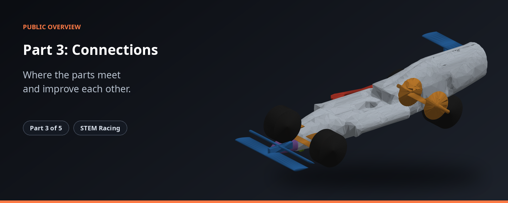
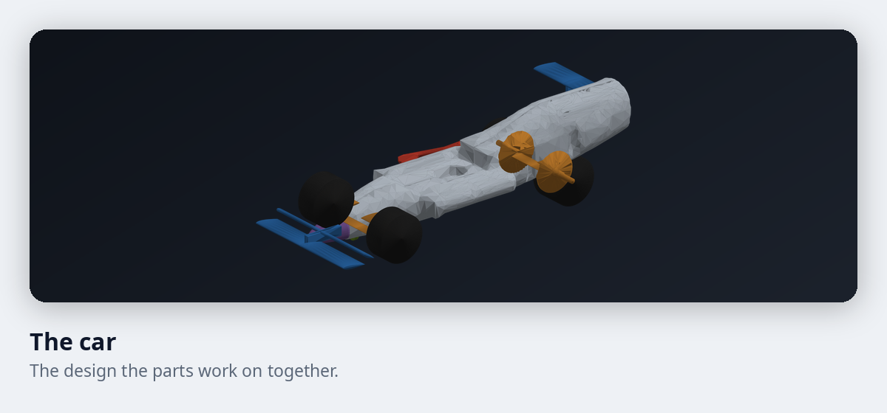
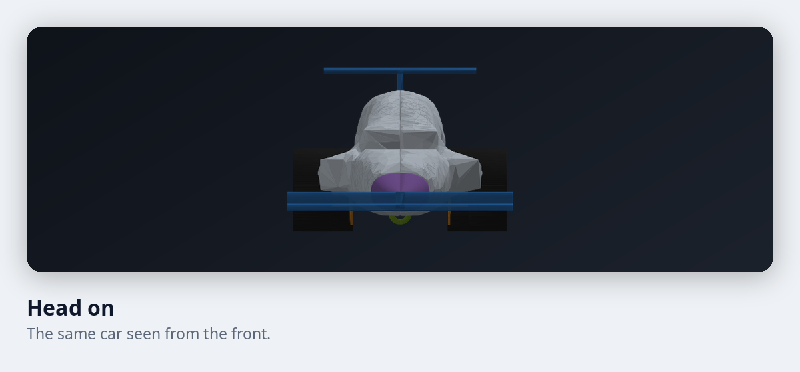

# STEM Racing, Part 3: Connections

**Where the parts meet and improve each other.**

Part 3 joins the body to the airflow results, so one design can be compared with another and improved.

| | |
|---|---|
| **Where it fits** | Part 3 of 5 in the STEM Racing toolkit |
| **What you get** | Designs that can be compared and ranked. |
| **Built for** | Student teams and their mentors |

## What it does

| Feature | What it gives you |
|---|---|
| Joins Parts 1 and 2 | Passes the body to the airflow and brings the results back, so designs can be compared. |
| Stability check | Checks that a design stays stable. |
| Knows when to stop | Decides when an improvement run has settled. |
| Balances the goals | Weighs air resistance, weight and balance point against each other. |

## A look at the car

<table>
<tr>
<td width="50%"></td>
<td width="50%"></td>
</tr>
</table>

These pictures are real output from the toolkit.

## How it fits

Part 3 is the link between the body and the airflow results. The full toolkit has five parts. See the [overview of the whole toolkit](https://github.com/Shashanksaraswat123939/stem-racing-overview).

| Part | Page |
|---|---|
| 1 | [Body](https://github.com/Shashanksaraswat123939/part1-overview) |
| 2 | [Airflow and race time](https://github.com/Shashanksaraswat123939/part2-overview) |
| 3 | [Connections](https://github.com/Shashanksaraswat123939/part3-overview) |
| 4 | [Components](https://github.com/Shashanksaraswat123939/part4-overview) |
| 5 | [Design advisor](https://github.com/Shashanksaraswat123939/part5-overview) |

## Status

| | |
|---|---|
| Project | Active |
| Source code | Private |
| This repository | Overview only, with no code |

## Credits

Made by [@Shashanksaraswat123939](https://github.com/Shashanksaraswat123939) and [@mxnviir](https://github.com/mxnviir).

## Rights

This page is a public overview of a private project. It contains no source code and does not describe how the project is built.

All rights reserved. You are welcome to read this page and share the link. You may not copy, reproduce or recreate the project from this material, and you may not use it to train, prompt or instruct automated systems to produce a copy. See the [LICENSE](LICENSE) file.
